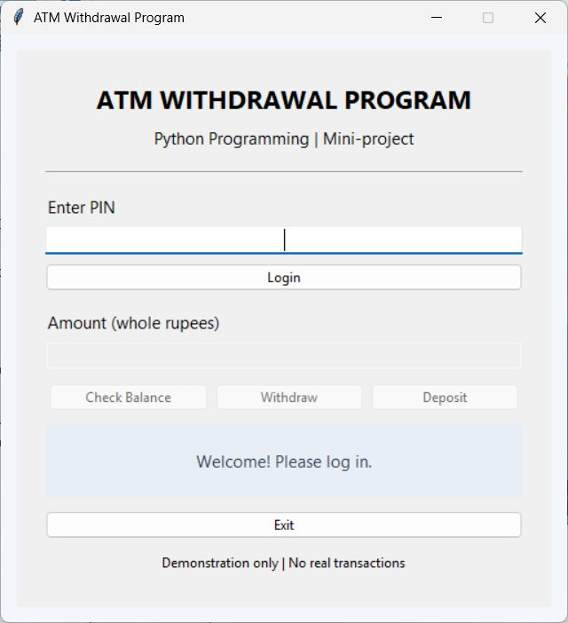
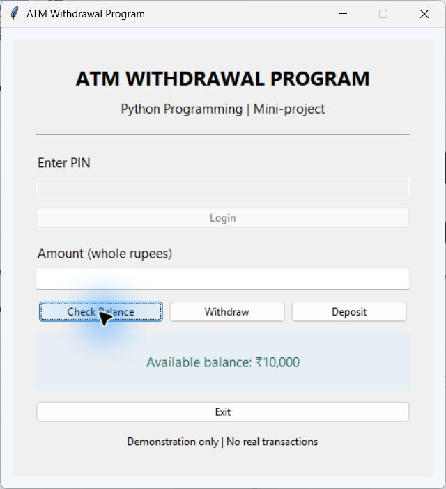
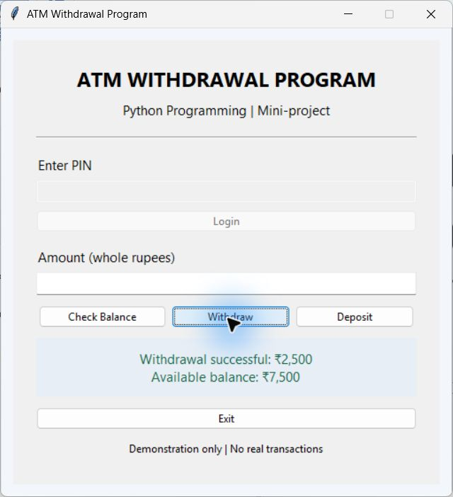
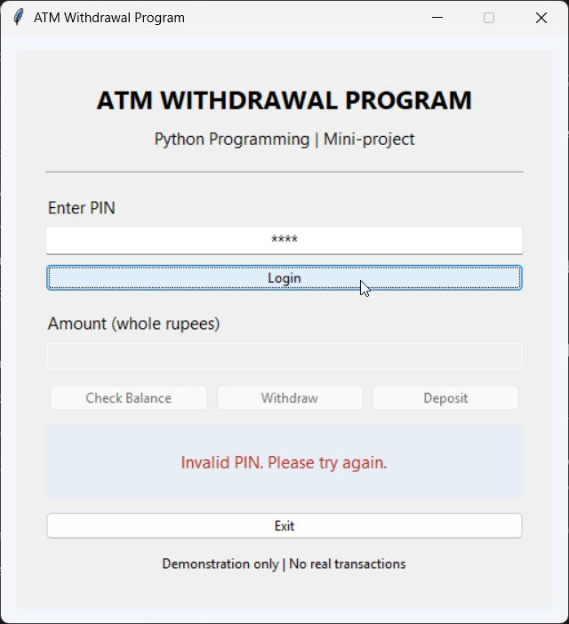

# ATM Withdrawal Program

A beginner-friendly **Python Programming** mini-project for Second-Year B.Tech Engineering, focused on exception handling with a simple Tkinter interface.

## Students

- **Kartik Kale** — Roll Number: **03**; PRN: **SOE25201020081**
- **Rutika Budhe** — Roll Number: **19**; PRN: **SOE25201020034**

## Features

- PIN verification with demonstration PIN `1234`.
- Initial balance of **₹10,000** and a Check Balance button.
- Withdraw and deposit positive whole-rupee amounts.
- Meaningful errors for wrong PINs, empty fields, invalid input, zero or negative amounts, and insufficient balance.
- Transaction controls remain disabled until successful login.
- Exit button to close the application.

This is a demonstration, with no real accounts or financial transactions. The balance resets to ₹10,000 whenever you restart the program. Amounts such as `12.5` are rejected because this project uses whole rupees.

## Run the application

1. Install Python 3 with Tkinter support. The standard Windows Python installer normally includes Tkinter.
2. Download or clone this repository and open a terminal inside the project folder.
3. Run:

```bash
python main.py
```

4. Enter PIN `1234` and click **Login**.
5. Click **Check Balance**, or enter an amount and click **Withdraw** or **Deposit**.
6. Click **Exit** to close the window.

No pip packages are required by the application. A graphical desktop is required. If Python reports that `tkinter` is missing, enable Tcl/Tk in your Python installation; on Debian/Ubuntu, install the `python3-tk` system package.

## Python concepts used

Variables; strings, integers and booleans; functions; `if`/`else`; lists and a loop for GUI buttons; `try`/`except`; `raise ValueError`; Tkinter widgets and callbacks. All application code is in `main.py`.

## Validation

Tested on Windows using Python 3.12 and Tk 8.6. **25 real-widget checks passed**, covering login, balance, deposits, withdrawals, invalid inputs, insufficient funds, exact-balance withdrawal, and the Exit button. Invalid transactions leave the balance unchanged. The report describes the test inputs and actual results.

## Actual application screenshots

### Login


### Dashboard and balance


### Successful withdrawal


### Error handling


## Project report

[Download the PDF report](ATM_Withdrawal_Program_Report.pdf)

The report contains the student details, abstract, objectives, methodology and flowchart, Python concepts, complete source code, genuine output screenshots, test results, conclusion, and repository link.

## GitHub repository

[ATM-Withdrawal-Program-Python](https://github.com/niiharbute/ATM-Withdrawal-Program-Python)
